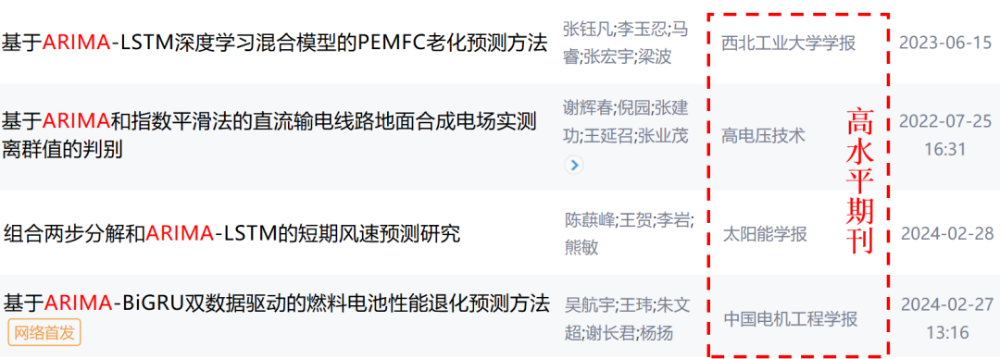
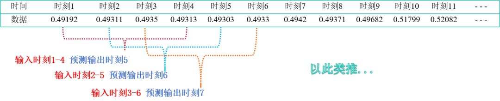
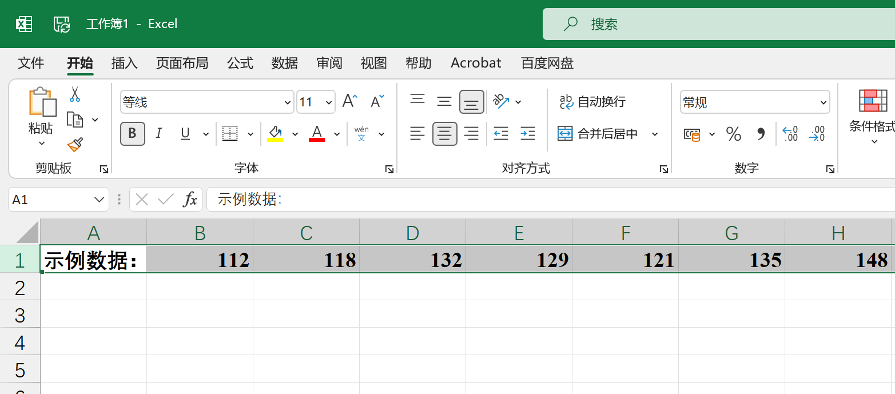
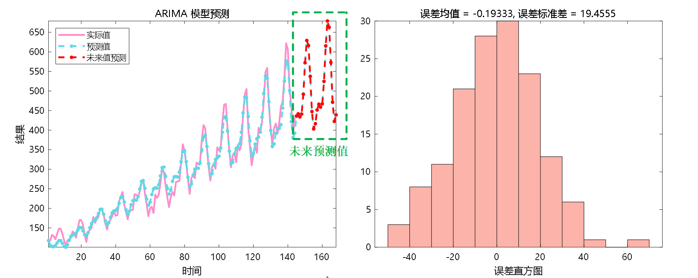
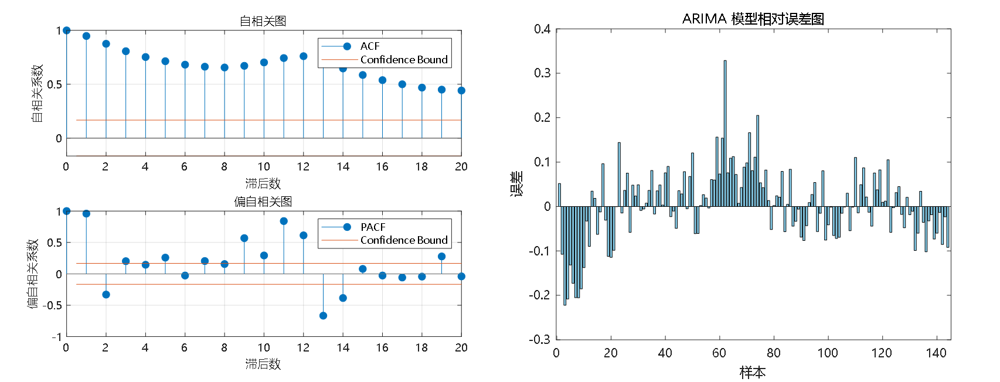

# Renowned ARIMA Time Series Forecasting (Autoregressive Integrated Moving Average Model! Predict future values based on historical values!)

The application platform for this product is Matlab 2021 and above.

Time series forecasting primarily aims to predict future values based on historical data patterns. Common research directions include: battery SOC, stock prediction, carbon price prediction, bearing life prediction, temperature, rainfall, wind speed, etc., weather variables prediction, traffic flow prediction for roads, railways, or air transportation, etc.! A model can nest multiple research directions. It has been widely published in high-level journals.
ARIMA model: namely the AutoRegressive Integrated Moving Average Model (AutoRegressive Integrated Moving Average Model), is a statistical model widely used for time series data analysis and prediction. The ARIMA model combines three main time series modeling methods: AutoRegression (AR), Difference (I), and Moving Average (MA). Below, we will briefly explain each part:

AutoRegression (AR):

The AutoRegression part represents the relationship between the current value and a series of values (lags) preceding it. It can be understood as that the current data point is weighted by one or more previous data points. Here, "auto" refers to itself, meaning that the current value is a function of its own past values.
Difference (I):

Moving Average (MA):

The Moving Average part considers the linear combination of the random error term and its lags in the model. This means that the current observation value is influenced by a series of past error terms. This part helps the model capture random fluctuations in the time series, even if there may be some influence or pattern in the lagged error terms.
By combining these three parts, the ARIMA model can describe and predict time series data with complex patterns, including those showing clear trends or seasonality. This makes the ARIMA model a very powerful tool in fields such as finance, machinery, electrical, new energy, etc., for prediction.
Data format:
Function: Time series forecasting is used to predict future trends of data that change over time, usually for processing time-related data, such as stock prediction, house price prediction, weather changes, etc.
Data format: Predict the value of moment 5 based on the values of moments 1-4, moment 6 based on the values of moments 2-5, and so on.
Prediction results:
Partial code

## Images

<!-- PAYMENT_BLOCK -->

## Get this dataset

- Payment link (Stripe): [Buy now](https://buy.stripe.com/3cs8yP7sY87d0vu9AB)
- Payment QR code: 

<!-- /PAYMENT_BLOCK -->
